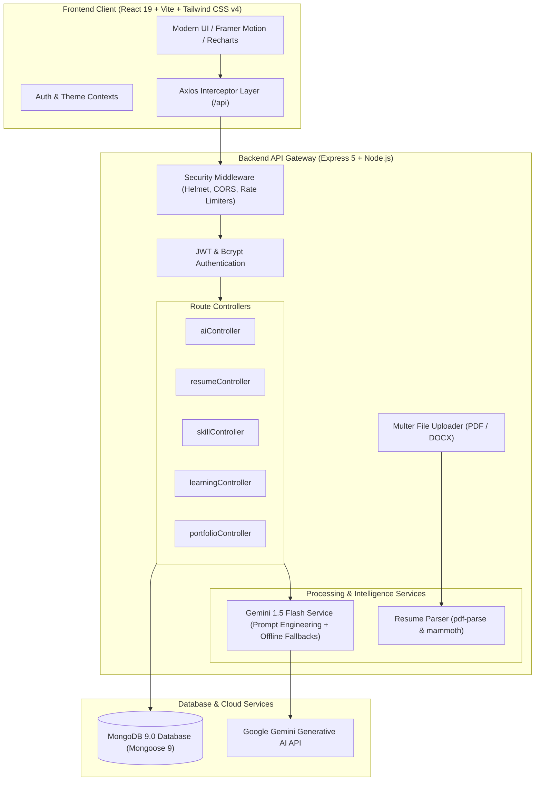

<div align="center">

# 🚀 FutureForge
### *AI-Powered Skill Optimization & Career Development Platform*

[](https://github.com/nava-07/futureforge)
[](https://ai.google.dev/)
[](https://react.dev/)
[](https://tailwindcss.com/)
[](LICENSE)

<p align="center">
  <strong>Transforming engineering students and aspiring developers into industry-ready software professionals through intelligent skill auditing, multi-dimensional ATS resume scoring, personalized roadmaps, and contextual AI career mentorship.</strong>
</p>

[Explore Features](#-key-features) • [System Architecture](#-system-architecture) • [Getting Started](#-getting-started) • [API Documentation](#-api-endpoints) • [Tech Stack](#-tech-stack)

</div>

---

## 📖 Table of Contents
- [Overview](#-overview)
- [Key Features](#-key-features)
- [System Architecture](#-system-architecture)
- [Tech Stack](#-tech-stack)
- [Project Structure](#-project-structure)
- [Getting Started](#-getting-started)
  - [Prerequisites](#prerequisites)
  - [Environment Setup](#environment-configuration)
  - [Running Backend & Frontend](#running-locally)
- [API Endpoints](#-api-endpoints)
- [Security & Architecture Highlights](#-security--architecture-highlights)
- [Offline Resilience & Fallbacks](#-offline-resilience--fallbacks)
- [License & Author](#-license--author)

---

## 🌟 Overview

Navigating the gap between academic curriculum and high-velocity tech hiring requirements is one of the hardest challenges faced by students and early-career developers. 

**FutureForge** bridges this chasm by acting as an autonomous, 24/7 AI Career Coach and Resume Intelligence Engine. Powered by **Google Gemini 1.5 Flash** and built on a high-performance **MERN** architecture, FutureForge provides comprehensive diagnostic assessments, pinpointing exact skill deficiencies for target roles, benchmarking resumes against modern Applicant Tracking Systems (ATS), generating multi-month learning milestones, and publishing public developer portfolios.

---

## ✨ Key Features

### 🧠 1. AI-Powered Skill Analysis & Gap Detection
- **Multi-Skill Auditing:** Evaluates 50+ technical and soft skills categorized into Frontend, Backend, DevOps, Data, and System Design.
- **Role Benchmarking:** Compares individual proficiencies against industry standards for roles like Full Stack Engineer, Cloud Architect, and ML Engineer.
- **Priority-Driven Gap Identification:** Generates immediate, high-impact recommendations to bridge technical shortcomings.

### 📄 2. ATS Resume Analyzer & Scorer
- **Document Ingestion:** Deep parsing of `.pdf` and `.docx` resumes using `pdf-parse` and `mammoth`.
- **Multi-Metric ATS Breakdown:** Evaluates formatting, readability, keyword saturation, metrics quantification, and section structure on an ATS scale of 0–100.
- **Keyword Gap Detection:** Identifies critical missing frameworks, cloud tools, and industry keywords tailored to modern recruitment pipelines.

### 🎯 3. Resume vs. Job Description Matching
- **Targeted Compatibility Scoring:** Upload or paste target Job Descriptions (JDs) to instantly compute keyword and experience match scores.
- **Impact-Oriented Suggestions:** Provides high-priority action items to tailor resumes specifically for target job postings.

### 📝 4. Intelligent Resume Builder with Live Export
- **Modern Templates:** Professional layout with real-time reactive previews.
- **AI Summary & Bullet Improver:** Elevates resume bullet points into quantified impact statements using Gemini action verbs.
- **One-Click PDF Generation:** Client-side vector PDF generation powered by `html2pdf.js`.

### 🌐 5. Public Developer Portfolio Showcase
- **Customizable Portfolio Pages:** Automatically generates hosted public portfolios at `/portfolio/:username`.
- **Dynamic Theming:** Select and preview distinct visual themes tailored for recruiter reviews.
- **Project & Certification Spotlights:** Displays verified skill proficiencies, GitHub projects, and credentials.

### 🗺️ 6. Personalized 3–6 Month Learning Roadmap
- **Step-by-Step Curriculum:** Structured month-by-month learning paths covering conceptual theory, curated courses, hands-on projects, and certifications.
- **Interactive Checkpoints:** Track progress, mark topics as completed, and calculate overall career readiness.

### 🤖 7. FutureForge AI Career Chat Assistant
- **Context-Aware Dialogue:** Converses with full awareness of your academic background, target roles, current skill levels, and uploaded resume data.
- **Actionable Guidance:** Answers tech interview questions, debugging strategies, system design queries, and career transitions.

---

## 🏛️ System Architecture



---

## 🛠️ Tech Stack

### Frontend
| Technology | Version | Purpose |
|---|---|---|
| **React** | `^19.2.8` | High-performance reactive UI component tree |
| **Vite** | `^8.2.0` | Next-gen blazing fast frontend build tooling and HMR |
| **Tailwind CSS** | `^4.3.3` | Utility-first responsive styling and glassmorphism |
| **Framer Motion** | `^13.1.0` | Fluid animations, smooth transitions, and modal effects |
| **Recharts** | `^3.10.1` | Interactive radar, bar, and progress analytics visualization |
| **Lucide React** | `^1.31.0` | Clean, modern iconography |
| **React Router** | `^7.18.2` | Declarative client-side routing & route protection |
| **html2pdf.js** | `^0.14.0` | Client-side vector PDF generation from DOM |
| **Axios** | `^1.19.0` | REST API communication with Bearer token interceptors |

### Backend
| Technology | Version | Purpose |
|---|---|---|
| **Node.js** | `>=18.x` | Asynchronous JavaScript runtime environment |
| **Express.js** | `^5.2.1` | High-throughput HTTP API web server |
| **MongoDB** | `>=7.0 / 9.0` | Flexible NoSQL document database |
| **Mongoose** | `^9.9.2` | Object Data Modeling (ODM) with strict schema validation |
| **Google Generative AI** | `^0.24.1` | Gemini 1.5 Flash SDK for real-time generative intelligence |
| **JWT & bcryptjs** | `^9.0.3` / `^3.0.3` | Stateless authentication, session tokens, and cryptographic password hashing |
| **pdf-parse & mammoth** | `^2.4.5` / `^1.12.1` | Deep extraction of unstructured text from PDF and DOCX files |
| **Multer** | `^2.2.0` | Multi-part form data parser for secure file uploads |
| **Helmet & Rate Limit** | `^8.3.0` / `^8.6.2` | HTTP header security and DDoS / brute-force rate-limiting protection |

---

## 📁 Project Structure

```
futureforge/
├── client/                               # React 19 Client Application
│   ├── public/                           # Static assets, SVG icons, favicon
│   ├── src/
│   │   ├── assets/                       # Illustrations and graphics
│   │   ├── components/
│   │   │   ├── chat/                     # AIChatbot interactive drawer
│   │   │   └── common/                   # Reusable UI (Modals, Gauges, Spinners, Badges)
│   │   ├── context/                      # AuthContext & ThemeContext
│   │   ├── layouts/                      # PublicLayout & DashboardLayout (SideNav + Header)
│   │   ├── pages/                        # 17 Feature pages (Dashboard, Resume, Skills, etc.)
│   │   ├── services/                     # Axios API clients for all endpoints
│   │   └── utils/                        # Formatters, constants, and helper utilities
│   ├── index.html                        # App HTML entry point
│   ├── vite.config.js                    # Vite configuration with /api backend proxy
│   └── package.json
│
├── server/                               # Express.js REST API Server
│   ├── config/                           # MongoDB connection manager (auto-reconnect)
│   ├── controllers/                      # Request handlers (Auth, AI, Resume, Skills, etc.)
│   ├── middleware/                       # JWT auth, Multer upload, Rate limiters, Validator
│   ├── models/                           # 16 Mongoose Data Models
│   ├── routes/                           # Express route definitions
│   ├── services/
│   │   ├── geminiService.js              # Gemini 1.5 Flash caller with offline fallbacks
│   │   └── resumeParser.js               # PDF and DOCX binary parsing engine
│   ├── utils/
│   │   └── prompts.js                    # System prompt templates & JSON constraints
│   ├── server.js                         # Server entry point & middleware pipeline
│   └── package.json
│
├── .env.example                          # Canonical environment configuration template
├── .gitignore                            # Comprehensive ignore rules (secrets, builds, node_modules)
├── LICENSE                               # MIT License
├── package.json                          # Monorepo root scripts
└── README.md                             # Comprehensive project documentation
```

---

## 🚀 Getting Started

### Prerequisites
- **Node.js:** v18.0.0 or higher
- **npm:** v9.0.0 or higher
- **MongoDB:** Local MongoDB instance running on `localhost:27017` or MongoDB Atlas URI
- **Google Gemini API Key:** Obtainable free from [Google AI Studio](https://aistudio.google.com/)

---

### Environment Configuration

1. Copy the `.env.example` file into `server/.env`:
```bash
cp .env.example server/.env
```

2. Configure your environment variables in `server/.env`:
```env
PORT=5000
NODE_ENV=development

# MongoDB Connection String
MONGODB_URI=mongodb://localhost:27017/futureforge

# JWT Authentication Secret
JWT_SECRET=your_super_secret_jwt_key_here_2026

# Google Gemini API Key
GEMINI_API_KEY=your_actual_gemini_api_key_here

# Client URL (for CORS validation)
CLIENT_URL=http://localhost:5173
```

---

### Running Locally

You can run FutureForge using two separate terminal instances:

#### Terminal 1 — Start Backend Server:
```bash
cd server
npm install
npm run dev
# Server will start on http://localhost:5000
```

#### Terminal 2 — Start Frontend Application:
```bash
cd client
npm install
npm run dev
# Frontend will start on http://localhost:5173
```

Open **[http://localhost:5173](http://localhost:5173)** in your browser!

---

## 🔌 API Endpoints

### 🔐 Authentication (`/api/auth`)
| Method | Endpoint | Description | Auth Required |
|---|---|---|---|
| `POST` | `/api/auth/register` | Register new user account | No |
| `POST` | `/api/auth/login` | Authenticate user & receive JWT | No |
| `GET` | `/api/auth/me` | Fetch authenticated user details | Bearer Token |
| `POST` | `/api/auth/forgotpassword` | Request password reset token | No |
| `PUT` | `/api/auth/resetpassword/:token` | Reset password using token | No |

### 📊 Skills & Assessment (`/api/skills`)
| Method | Endpoint | Description | Auth Required |
|---|---|---|---|
| `GET` | `/api/skills` | Fetch all user recorded skills | Bearer Token |
| `POST` | `/api/skills/analyze` | Run Gemini AI Skill Gap Analysis | Bearer Token |
| `GET` | `/api/skills/assessment` | Retrieve latest skill assessment | Bearer Token |
| `POST` | `/api/skills/assessment` | Save updated skill proficiencies | Bearer Token |

### 📑 Resume & Job Matching (`/api/resume` & `/api/job-match`)
| Method | Endpoint | Description | Auth Required |
|---|---|---|---|
| `POST` | `/api/resume/upload` | Upload resume (`.pdf` / `.docx`) & extract text | Bearer Token |
| `POST` | `/api/resume/analyze` | Generate full ATS score breakdown | Bearer Token |
| `POST` | `/api/resume/enhance-summary`| AI-rewrite of professional summary | Bearer Token |
| `POST` | `/api/resume/improve-bullet` | AI-enhance individual bullet points | Bearer Token |
| `POST` | `/api/job-match/match` | Match resume text against a Job Description | Bearer Token |

### 🎓 Learning & Projects (`/api/learning-path` & `/api/projects`)
| Method | Endpoint | Description | Auth Required |
|---|---|---|---|
| `GET` | `/api/learning-path` | Retrieve personalized learning roadmap | Bearer Token |
| `POST` | `/api/learning-path/generate`| Generate AI roadmap based on skill gaps | Bearer Token |
| `PUT` | `/api/learning-path/item/:id`| Toggle completion status of learning item | Bearer Token |
| `GET` | `/api/projects/recommended` | Fetch AI-recommended projects | Bearer Token |

### 🤖 AI Career Assistant (`/api/ai`)
| Method | Endpoint | Description | Auth Required |
|---|---|---|---|
| `POST` | `/api/ai/chat` | Send prompt to FutureForge AI assistant | Bearer Token |
| `GET` | `/api/ai/conversation` | Fetch conversation history | Bearer Token |
| `POST` | `/api/ai/career-guidance`| Generate target career readiness scores | Bearer Token |

---

## 🛡️ Security & Architecture Highlights

- **JWT Authentication:** Strict stateless Bearer token authentication with verification middleware.
- **Cryptographic Hashing:** Salted `bcryptjs` hashing for passwords with pre-save mongoose hooks.
- **DDoS & Brute-Force Rate Limiting:** Tiered rate limiters:
  - `authLimiter`: 10 requests / 15 minutes for login & register.
  - `aiLimiter`: 30 requests / 15 minutes for AI endpoints to prevent quota exhaustion.
  - `generalLimiter`: 200 requests / 15 minutes for data reads.
- **Security Headers:** Comprehensive HTTP header shielding with `helmet`.
- **CORS Protection:** Configured to strictly allow authorized frontend origins.
- **File Sanitization:** File type checking, size limitations (10MB max), and secure disk naming via `multer`.

---

## 🔄 Offline Resilience & Fallbacks

FutureForge is designed with **enterprise resilience** in mind. If the external Gemini API is unreachable, quota-throttled, or running without an API key:
- Every AI service (`analyzeSkills`, `analyzeResume`, `matchResumeToJob`, `generateLearningPath`, `chat`, etc.) includes graceful fallback mechanisms.
- The platform automatically returns realistic, structured diagnostic models and recommendations, ensuring the application remains 100% interactive and testable during offline demonstrations or evaluations.

---

## 👨‍💻 Author & Acknowledgments

Created by **Navaneeth P** ([@nava-07](https://github.com/nava-07))

- Powered by **[Google Gemini AI](https://deepmind.google/technologies/gemini/)**
- Built with the **[MERN Stack](https://www.mongodb.com/mern-stack)** & **[Tailwind CSS](https://tailwindcss.com/)**

---

<div align="center">
  <sub>FutureForge — Forge Your Skills. Shape Your Future.</sub>
</div>
